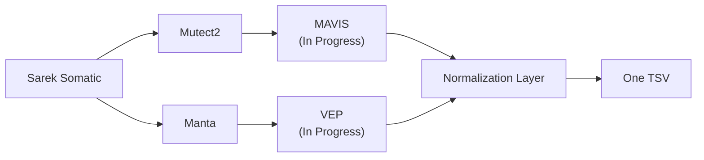
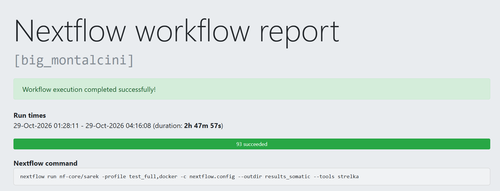

## Germline anaysis paired with somatic analysis using sarek[^1]  
- contains aws setup script: setup_insance.sh
- Normal sequencing pipeline discover SNV's single nucleotide variants
- Tumor sequencing pipeline discover SV's structural variants
- Produces one unified report including SNV's for normal sequence analysis and SV's for cancer specific analysis

### Pipeline:



#### Testing pipeline:
- ran small test on consumer grade laptop with ```bash nextflow run nf-core/sarek -profile test,docker -c nextflow.config --outdir results -resume```
- ran full test on aws spot instance with 32 cores use parallelism [^2] ```nextflow run nf-core/sarek -profile test full,docker -c nextflow.config --outdir results_somatic --tools strelka```




### Citations:

[^1]:Garcia M, Juhos S, Larsson M et al. Sarek: A portable workflow for whole-genome sequencing analysis of germline and somatic variants [version 2; peer review: 2 approved] F1000Research 2020, 9:63 doi: 10.12688/f1000research.16665.2.

[^2]: Friederike Hanssen, Maxime U Garcia, Lasse Folkersen, Anders Sune Pedersen, Francesco Lescai, Susanne Jodoin, Edmund Miller, Oskar Wacker, Nicholas Smith, nf-core community, Gisela Gabernet, Sven Nahnsen Scalable and efficient DNA sequencing analysis on different compute infrastructures aiding variant discovery bioRxiv doi: 10.1101/2023.07.19.549462.
